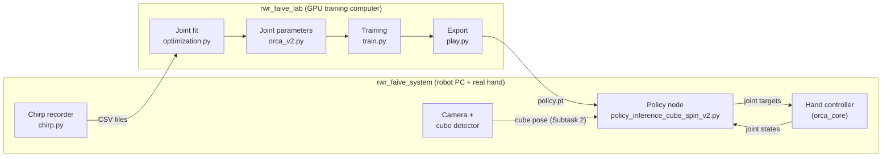

# Real World Robotics — Task 1

## Sim2Real for In-Hand Manipulation

*ETH Zürich · Soft Robotics Laboratory · HS 2026*

---

## 1 Introduction

In-hand manipulation is the ability to turn and move an object in a robot hand without other support. It is one of the basic problems in robotics. For humans, it is easy. For a robot hand, it is difficult for three reasons:

- The state space and the action space have many dimensions.
- The contact dynamics are complex.
- Precise sensorimotor coordination is necessary.

Reinforcement learning (RL) is a good method to learn dexterous manipulation policies, if you train them in simulation. But there is a gap between simulation and reality (the sim2real gap). A policy that you train only in simulation frequently does not operate correctly on the physical hardware. The causes are dynamics that the model does not include, sensor noise, actuator delays and manufacturing tolerances.

In this task, you do sim2real transfer for cube rotation with the ORCA v2 hand. You train an RL policy in Isaac Lab. Isaac Lab is a high-fidelity physics simulator that runs many environments in parallel on a GPU. Then you deploy the policy on the physical ORCA v2 hand that you assembled at the start of this course. With this task, you get practical experience with domain randomization, system identification and the problems of sim2real transfer in contact-rich tasks.

For this task, you get this document and two repositories: `rwr_faive_lab` (simulation) and `rwr_faive_system` (real robot). You get `rwr_faive_lab` now. We will give you `rwr_faive_system` soon. The README files in the two repositories give the installation procedures and more commands. Table 1 gives the important data. Items with the label **TBA** are not known yet. We will give them later.

| Item | Value |
|---|---|
| **Task start** | Monday, 19 October 2026 |
| **Demo day** | Monday, 9 November 2026 |
| **Hand** | ORCA v2, right hand, 17 actuated joints |
| **Cube** | 45 mm side length, 3D-printed PLA |
| **Repositories** | `srl-ethz/rwr_faive_lab`, branch `main`. `rwr_faive_system`: **TBA** (we will give it soon) |
| **Simulator** | Isaac Lab 2.3.2 with Isaac Sim 5.1 (Python 3.11) |
| **Robot software** | ROS 2 Jazzy; the ORCA v2 driver is `orca_core` 0.5.2 |
| **Robot PC** | Lenovo Legion laptop with an NVIDIA GPU |
| **Control frequency** | 20 Hz in the simulation and on the real robot |

*Table 1: Important data*

---

## 2 Deliverables and evaluation

To pass this task, you must complete the subtasks that follow. Each subtask has two lists:

- The first list shows a possible procedure.
- The second list gives the deliverables. You show these deliverables on the demo day, **Monday, 9 November 2026**. Your grade is based on these deliverables.

For the **live demo** parts, you get more points if the hand turns the cube **fast** and for a **long time** without a drop.

### 2.1 Subtask 0 – Run the simulation pipeline

For this subtask, no development is necessary. You use only `rwr_faive_lab`. Install it, run the training in simulation, and learn how the RL environment operates.

- Install Isaac Lab and `rwr_faive_lab`. Refer to Sections 3 and 5.
- Read the code of `rwr_faive_lab`. Start with the task configuration (Section 6.1).
- Train the proprioception-only 20 Hz policy. Refer to Section 6.
- Monitor the training progress in Weights & Biases.
- Play the trained policy in the simulation and export it. Refer to Section 6.4.

**Deliverables**

- None.

### 2.2 Subtask 1 – Identify the joints of your hand and tune the RL environment

The RL environment and the real robot use a control frequency of 20 Hz. This is the same frequency as the vision-based cube tracker. The joint parameters in `orca_v2.py` are provisional values from the ORCA v1b hand. Your ORCA v2 hand is different, for example in tendon tension, friction and assembly tolerances. For this reason, you identify the joint parameters of **your** hand.

- Record the chirp signal for each joint type on your real hand: the wrist, all joints of the thumb, and all joints of one finger. We use the same characteristics for equivalent joints, for example `index_mcp` and `ring_mcp`. Refer to Section 7.1.
- (Optional) You can also change the joint controller parameters on the real hand.
- Use the given optimization code to find Isaac Sim joint parameters that agree with the response of your real hand. Refer to Section 7.2.
- Write your joint parameters into `orca_v2.py`. Refer to Section 7.3.
- Run your policy on the real hand. Refer to Section 8.1.
- With your joint parameters, adjust the domain randomization (observation noise, physics parameters, object scale), the reward types, the reward scales and the observations. The objective is a better performance of the RL policy on the real robot. Refer to Section 6.1.

**Deliverables**

- 2–3 slides about the joint parameter characterization and the fit procedure. Show how well the Bode plots of the real joints and the simulated joints agree, compared to the original parameters.
- 2–3 slides about the changes to the RL environment. Show how each change affects the performance of the simulated robot and the real robot.
- **Live demo:** show the RL policy on the robot. Record a video as a backup.

### 2.3 Subtask 2 – Add exteroception

Add exteroception to the system with the cube tracker.

- Add the cube position and the cube orientation to the observations of the RL policy.
- Integrate the real-time cube pose from the visual tracker into the code for the real robot. Refer to Sections 8.2 to 8.4.

**Deliverables**

- 2–3 slides about the changes to the full system. Show how the changes affect the performance of the simulated robot and the real robot.
- **Live demo:** show the RL policy on the robot. Record a video as a backup.

### 2.4 Optional subtask – Turn the cube around all axes

This subtask is optional and more difficult. Try to do the same as the DeXtreme[^1] paper, and turn the cube around all axes.

- Option 1: train with angular velocity commands around all three axes, not only around the z-axis.
- Option 2: use target orientations as commands, not angular velocities. For this option, you must change much of the code.

**Deliverables**

- The same as for Subtask 2.

---

## 3 Work on your repositories

Fork `rwr_faive_lab` and `rwr_faive_system` to GitHub[^2]. Each team uses one fork of each repository, and all team members work on these forks. Use the branch `main` in the two repositories.

> [!NOTE]
> **TBA:** `rwr_faive_system` is not available yet. We will give it to you soon, and we will tell you on Slack. Then fork it in the same way as `rwr_faive_lab`. Subtask 0 uses only `rwr_faive_lab`.

| Repository | Upstream | Contents |
|---|---|---|
| `rwr_faive_lab` | `srl-ethz/rwr_faive_lab` | Isaac Lab environment, RL training, joint parameter fit (simulation side) |
| `rwr_faive_system` | **TBA** | ROS 2 software for the real hand: hand control, chirp recorder, camera, cube detector, policy node |

Figure 1 shows how the two repositories work together. Data goes in two directions:

- From the real hand to the simulation: the chirp recordings from `rwr_faive_system` go to the fit in `rwr_faive_lab`.
- From the simulation to the real hand: the exported policy from `rwr_faive_lab` goes to the policy node in `rwr_faive_system`.



*Figure 1: The data flow between the two repositories*

**Install Git LFS before you clone.** The two repositories keep large files in Git LFS: the hand model files (`.usd`) in `rwr_faive_lab`, and the cube detector models in `rwr_faive_system`. Without Git LFS, these files are only small pointer files of approximately 130 bytes, and the programs cannot load them.

```bash
sudo apt install git-lfs
git lfs install
git clone git@github.com:<team>/rwr_faive_lab.git
```

If you cloned a repository before you installed Git LFS, do `git lfs pull` in the repository.

Clone your forks with the **SSH URL** (`git@github.com:<team>/<repository>.git`). Then you can push without a password.

During the course, we can change the two repositories to add features or to repair bugs. We will tell you on Slack if there is a large change.

---

## 4 Compute

We will give you the information about the compute for the training separately.

The training with `--num_envs 8192` uses much GPU memory. Last year, a GPU with 24 GB of memory was sufficient.

You can also train on your own computer. Use Isaac Lab 2.3.2 with Isaac Sim 5.1 (Python 3.11). We did not test other versions. If you use your own computer, you must find and repair compatibility problems with Isaac Sim, CUDA or PyTorch yourself.

---

## 5 Simulation setup

Isaac Lab[^3] is a modular framework for robot learning. It uses NVIDIA Isaac Sim. It simulates physics on the GPU with PhysX, and it can run many environments in parallel. For this reason, the training of RL policies is fast.

In this task, you use `rwr_faive_lab`. It is an extension of Isaac Lab for the ORCA v2 hand. Obey its README, but use the SSH URL of your fork when you clone the repository. In summary:

1. Install Isaac Lab with the official installation guide[^4]. Use the **conda** installation, because it is easier to run Python scripts from the terminal.
2. Install Git LFS. Then clone your fork **outside** the `IsaacLab` directory.
3. Install the extension in editable mode. Use the Python environment that contains Isaac Lab. Do all commands from the root directory of the repository:

   ```bash
   python -m pip install -e source/faive_lab
   ```

4. Make sure that the installation is correct. The first command must show the task `orca-v2-inhand-repose-v0`:

   ```bash
   python scripts/list_envs.py
   python scripts/rsl_rl/train.py --task=orca-v2-inhand-repose-v0 --num_envs 2
   ```

---

## 6 RL training

### 6.1 Task

The task definitions are in `source/faive_lab/faive_lab/tasks/orca_inhand`. The task ID is `orca-v2-inhand-repose-v0`.

#### 6.1.1 `orca_v2_repose_env_cfg.py`

This file contains the configuration of the task. It defines these items:

- The action space, the observation space and the reward functions.
- The domain randomization parameters.
- The physics configuration and the control frequency: physics at 120 Hz and `decimation = 6`. This gives 20 Hz control. One episode is 32 s.
- The command: a target angular velocity of the cube around the vertical axis, from 0.9 to 1.5 rad/s in the two directions. The command changes every 8 s.

The observation space (group `policy`, 74 values) contains these items, in this order:

- The **joint positions**, normalized to [−1, 1] with the joint limits (17 values).
- The **joint velocities**, multiplied by 0.2 (17 values).
- The **goal rotation command**: the target cube position and the target angular velocity (6 values).
- The **last raw action of the policy** (17 values).
- The **last joint command sent to the robot** (17 values).

The action space is the **joint position targets** of the 17 joints. The action term scales the network output to the joint limits. Then it applies an exponential moving average (EMA) with α = 0.2.

#### 6.1.2 Reward functions

The reward functions define how your policy learns. With the correct reward functions, you push the system to complete the task. The system gets a positive reward for actions that help to complete the objective. The system gets a penalty for actions that prevent this, for example a drop of the cube. The **weights of the rewards** set the priority of each subtask.

Examine the reward functions in the configuration file. Find the answers to these questions:

- How do we push the system to hold the cube?
- How do we make the system turn the cube in a specified direction at a specified speed?
- How do we control the joint speeds to prevent uncontrolled movement?

#### 6.1.3 Domain randomization

Domain randomization is a sim2real method. During the training, the simulation parameters change randomly, for example friction, masses or textures. The policy learns the features of the task that do not change. It does not learn the special features of the simulator. Then the real world is only one more variation that the policy knows. Because the training has many variations, the policy operates correctly in more conditions.

In `orca_v2_repose_env_cfg.py`, you can randomize these items:

- The joint position at reset and the joint position limits.
- The material of the hand, the link masses and the joint parameters.
- The material of the cube, its mass and its start position.
- The gravity vector of the scene.

### 6.2 Run the training script

When the configuration of the task is complete, start the training with this command:

```bash
python scripts/rsl_rl/train.py --task=orca-v2-inhand-repose-v0 --headless --num_envs 8192 --logger wandb --video --video_interval 4000
```

The script has these arguments:

- `--headless`: run without live visualization.
- `--video`: record videos during the training.
- `--video_length`: the length of the recorded video (in steps).
- `--video_interval`: the interval between two video recordings (in steps).
- `--num_envs`: the number of environments in the simulation.
- `--seed`: the seed for the environment.
- `--max_iterations`: the number of RL training iterations.
- `--run_name`: a suffix for the name of the run folder.

The script saves each run in this folder:

```
logs/rsl_rl/orca_v2_repose/<date_time>/
```

The folder contains the checkpoints (`model_<iteration>.pt`), the training videos and the configuration of the run (`params/`). Keep the configuration files. They are the record of your training settings.

### 6.3 Logging and visualization with Weights & Biases

Use Weights & Biases[^5] to monitor the training progress. Do `wandb login` one time and give your API key. The training then sends the data to a dashboard in your account. On the dashboard, you can monitor the rewards, the episode lengths, the RL losses, the success metrics and more. Each reward term shows as `Episode_Reward/<term>`. The metrics of the rotation command show as `Metrics/continuous_rotation/<metric>`. The monitoring is an important step to find and repair problems.

### 6.4 Play and export the policy

```bash
python scripts/rsl_rl/play.py --task=orca-v2-inhand-repose-v0 --num_envs 16
```

- The script loads the last checkpoint of the last run. To select a different checkpoint, use `--checkpoint <full path to model_XXXX.pt>`.
- The script exports the policy to `exported/policy.pt` (TorchScript) and `exported/policy.onnx` in the folder of the run. The export includes the observation normalizer. Use `policy.pt` on the real hand (Section 8.1).

---

## 7 System identification

System identification (SysID) makes the sim2real transfer better. You adjust the simulation parameters, for example joint friction, damping and stiffness, until the simulated motion agrees with the real motion. For this, you send the same trajectory to the real hand and to the simulated hand. Then you change the parameters to decrease the difference between the two frequency responses. The result is a simulation that is more similar to the real dynamics. As a result, the policy operates better on the real robot.

The procedure has three steps:

1. Record a chirp signal on each joint type of the real hand (`rwr_faive_system`).
2. Fit the simulated joint parameters to each recording (`rwr_faive_lab`).
3. Write the parameters into the hand configuration (`rwr_faive_lab`).

### 7.1 Record chirps on the real hand

> [!NOTE]
> This section uses `rwr_faive_system`. We will give you this repository soon (Section 3). Until then, use this section to prepare. The file names and the commands can change in the released version.

The chirp recorder is `experiments/orca/chirp.py` in `rwr_faive_system`. It connects to the hand directly through `orca_core`. It does **not** use ROS. For the full procedure, refer to `experiments/orca/README.md`.

> [!CAUTION]
> Remove all loads from the hand before you start a recording. Make sure that the hand can move freely. First, do a test with one joint and a small amplitude, for example `--joints index_mcp --amplitude-deg 3`. To see the plan without a movement, use `--dry-run` and not `--execute`.

1. Make a separate Python environment for the recorder (one time). Do these commands in the root directory of `rwr_faive_system`:

   ```bash
   python3.12 -m venv .venv.chirp
   source .venv.chirp/bin/activate
   python -m pip install orca_core==0.5.2 scipy
   ```

2. Tension and calibrate the hand with the ROS procedure (Section 8.1). The recorder does not calibrate the hand.
3. Use the `config.yaml` of your hand. The `calibration.yaml` of the hand must be in the same folder. After the ROS calibration, use the **installed** file:

   ```
   ~/ros_ws/install/hand_control/share/hand_control/orca/configs/orcahand_v2/right/config.yaml
   ```

4. Stop the ROS controller, the joint GUI and all other programs that use the serial port.
5. Record the 8 joint types:

   ```bash
   python experiments/orca/chirp.py --config /path/to/config.yaml \
     --joints wrist thumb_cmc thumb_abd thumb_mcp thumb_dip index_abd index_mcp index_pip \
     --ctrl-freq 20 --duration 20 --f0 0.1 --f1 5 --amplitude-deg 10 --execute
   ```

For each joint, the script moves one joint and keeps all other joints at `neutral_position`. It sends a logarithmic sweep from 0.1 Hz to 5 Hz in 20 s, with ±10° around the middle of the joint range. At 20 Hz, this gives 400 samples. The script writes one directory for each run:

```
logs/chirp_v2/<timestamp>/
    metadata.json
    chirp_<joint>_<timestamp>_ctrl20Hz_20.0s_0.1-5.0Hz_10deg.csv    (one file for each joint)
```

The CSV columns are `timestamp` (s), `commanded_position` (degrees) and `measured_position` (degrees). Use only runs that have the status `complete` in `metadata.json`. To plot a recording, use `experiments/orca/plot.py`.

### 7.2 Fit the joint parameters

In `rwr_faive_lab`, the fit scripts are in the folder `scripts/motor_param_characterization`. The README in that folder and the documentation at the top of each script give more information.

The script `optimization.py` uses your real recording as the ground truth. It replays the same chirp on 100 simulated joints in parallel, each joint with different parameters. Then it calculates the frequency response function (FRF) of each simulated joint and compares it with the real FRF. Bayesian optimization (a Gaussian process model with expected improvement) selects the next 100 parameter sets. The script repeats this `--nfev` times (default: 4). It fits these parameters for one joint:

- stiffness (range 0.1 to 15), damping (range 0 to 3), friction (range 0 to 10) and effort limit (range 0.5 to 2.0).
- The armature stays at 0.

Do these steps in the Python environment that contains Isaac Lab:

1. Install the packages for the fit (one time):

   ```bash
   python -m pip install scikit-optimize pandas
   ```

2. Copy your chirp recordings to the training computer.
3. Go to the folder of the scripts. The scripts must run from this folder:

   ```bash
   cd scripts/motor_param_characterization
   ```

4. Do the fit for each joint type. The simulator name of a joint is the recorder name with the prefix `right_`, for example `index_mcp` → `right_index_mcp`:

   ```bash
   python optimization.py --joint_name right_index_mcp \
     --ground_truth <your_data_dir>/chirp_index_mcp_<timestamp>_ctrl20Hz_20.0s_0.1-5.0Hz_10deg.csv
   ```

The script writes its results to `logs/optimizations/<joint>_<timestamp>/`: the log of the optimization (`log.csv`, `log.png`) and the comparison of the best fits with the real FRF (`frf_comparison.png`). The output of the script shows the best parameters.

> [!NOTE]
> The simulated chirp in `chirp_characterization.py` must be the same as the real chirp: 20 s, 0.1 Hz to 5 Hz, ±10°, 20 Hz. If you change the chirp on the real hand, also change it in `chirp_characterization.py`.

> [!NOTE]
> The folders `202506_collected_realworld_data` and `202510_orcav1b_realworld_data` contain recordings from older hands at 40 Hz. Use them only as examples. Do not use them as the ground truth for your ORCA v2 hand.

If a best value is at the limit of its range, the real value can be outside the range. In that case, make the range larger in `optimization.py` and do the fit again.

### 7.3 Use the parameters in the simulation

The file `source/faive_lab/faive_lab/assets/orca_v2.py` contains the physics configuration of the ORCA v2 hand. For each joint, it sets `stiffness`, `damping`, `friction`, `armature` and `effort_limit_sim`. Write your fitted values into this file. The index values apply also to the middle, ring and pinky fingers. The RL environment uses this file. As a result, the next training uses your values.

For your slides, compare the Bode plots of the real joint, the joint with the original parameters and the joint with your parameters:

1. Replay the chirp with a parameter set, for example the original values for `right_index_mcp`. The script writes a CSV file to `logs/characterization/`:

   ```bash
   python chirp_characterization.py --headless --joint_name right_index_mcp \
     --stiffness 11.8 --damping 1.2 --friction 0.003 --armature 0.0 --effort_limit 0.78
   ```

2. Plot the recordings together:

   ```bash
   python plot_chirp_utils.py <real.csv> <original.csv> <fitted.csv> --labels real original fitted
   ```

---

## 8 Real-world deployment

> [!NOTE]
> This section uses `rwr_faive_system`. We will give you this repository soon (Section 3). Until then, use this section to prepare. The file names and the commands can change in the released version.

When the policy completes the task in simulation, deploy it on the real hand. Use the `rwr_faive_system` repository to connect to the hand and the real system. Use this code also for Task 2. For this task, use mainly the files in `experiments/rl_inference` and `experiments/launch`.

The software uses ROS 2 Jazzy. Install it with RoboStack and pixi, as the README of `rwr_faive_system` tells you. With pixi, put `pixi run` before each command. The ORCA v2 driver `orca_core` has a separate installation step. Refer to `src/hand_control/README.md`.

The robot PC is a Lenovo Legion laptop with an NVIDIA GPU. The cube detection uses the GPU.

The system contains these components:

- The hand controller (ORCA v2, through `orca_core`).
- The policy node `experiments/rl_inference/policy_inference_cube_spin_v2.py`.
- For Subtask 2: the OAK-D camera, the AprilTag calibration and the cube detection node.

> [!CAUTION]
> Make sure that the servo wiring is correct before you connect the power. The ORCA servos have no reverse-polarity protection. Incorrect wiring can cause damage to the servos.

> [!IMPORTANT]
> The policy node contains fixed values for the joint limits, the joint order, the observation order, the observation size `OBS_DIM` (74) and the scales. These values must be the same as in `orca_v2_repose_env_cfg.py`. If you change the observation or the action in `rwr_faive_lab`, you must also change the policy node. An incorrect size gives an error. An incorrect order or scale gives no error, but the policy does not operate correctly.

### 8.1 Prepare the hand and run a policy

For the full procedure, refer to `src/hand_control/README.md` and `experiments/README.md`.

> [!WARNING]
> Keep your fingers away from the hand during the calibration. The joints move to their end stops and can pinch your fingers.

> [!CAUTION]
> The policy node sends commands to the hand **immediately** when it starts. First, start each new policy with `dry_run:=true`. An incorrect policy can cause damage to the hand. To stop the hand in an emergency, do this command:
>
> ```bash
> ros2 service call /right/hand/estop std_srvs/srv/SetBool "{data: true}"
> ```
>
> When you stop the policy node with Ctrl+C, the hand holds its last commanded pose.

1. **Tension the tendons** after the assembly, and when the tendons are slack (`src/hand_control/orca/tensioning_v2.py`).
2. **Calibrate the hand** one time after you tension the tendons:

   ```bash
   ros2 launch hand_control orcahand_v2_controller_launch.yaml hand_chirality:=right calibrate:=true launch_rviz:=true
   ```

   The controller keeps the calibration in `calibration.yaml` in the `install/` folder of the workspace. If you remove `install/`, you must calibrate again.

3. **Move each joint with the joint GUI** and make sure that it operates correctly:

   ```bash
   ros2 launch experiments orcahand_v2_joint_gui.launch.py
   ```

4. In terminal 1, start the hand controller:

   ```bash
   ros2 launch hand_control orcahand_v2_controller_launch.yaml hand_chirality:=right launch_rviz:=true
   ```

5. In terminal 2, start the policy in dry-run mode. The node calculates and logs the actions, but it does not move the hand:

   ```bash
   ros2 run experiments policy_inference_cube_spin_v2.py --ros-args \
     -p policy_ckpt_path:=/path/to/exported/policy.pt -p dry_run:=true
   ```

6. Examine the log. The normalized joint positions must be between −1 and 1.
7. Stop the dry run with Ctrl+C. Then start the policy again without `dry_run`.

Useful parameters of the policy node (add each as `-p name:=value`):

- `goal_ang_vel`: the commanded rotation speed in rad/s. The sign sets the direction.
- `goal_flip_period_s`: if more than 0, the node changes the direction at this interval (in seconds).
- `csv_log_path`: write the observations and the joint commands to this CSV file.
- `policy_hz`: the policy frequency. It must be 20, the same as in the training.

> [!NOTE]
> At reset, the simulation sets each joint near its zero position (±20 % of its limits). The real hand starts at `neutral_position` of its `config.yaml`. For some joints, these two poses are far apart. Compare them, and move the hand to a pose similar to the simulation, or change the reset in the simulation.

### 8.2 Cube detection

The cube detection node (`experiments/rl_inference/cube_detection_node.py`) operates as follows:

- A **Mask R-CNN** network finds the keypoints at the corners of the cube in the camera image. The model is in `experiments/rl_inference/pose_estimation` (Git LFS files).
- A **PnP**[^6] algorithm with RANSAC calculates the 3D pose of the cube from these keypoints. The node publishes the pose as the TF `oakd_bottom_view_frame` → `cube`, at a maximum of 20 Hz.
- A Kalman filter smooths the position, and slerp smooths the orientation. The smoothing decreases the noise, but it adds lag.

Use the current cube detection as a basis. You can make it better, for example with a different smoothing filter, more viewpoints or adjusted PnP parameters.

Start the detector:

1. Write the ID of your camera (printed on the camera) into `experiments/cfgs/cams/oakd_cube_task.yaml`. Connect the camera to a USB 3 port with a USB 3 cable.
2. Start the camera, the cube detector and RViz:

   ```bash
   ros2 launch experiments cube_spin_v2.launch.py \
     model_path:=/path/to/pose_estimation/finetuned_models/maskrcnn-finetuned_lightning_new_adamw.ckpt
   ```

3. Make sure that the detection is correct. In RViz, the cube must follow the real cube when you move and turn it. The command `ros2 run tf2_ros tf2_echo oakd_bottom_view_frame cube` shows the cube position relative to the camera. Compare the distance with a ruler measurement.

If the detector stops with the error `invalid load key, 'v'`, the model files are still Git LFS pointer files. Do `git lfs pull` in `rwr_faive_system`.

### 8.3 Camera calibration and the tag-to-hand transform

To get the cube pose in the frame of the hand, the system needs two transforms:

- **Camera → tag:** the AprilTag calibration measures it.
- **Tag → hand:** you measure it on your setup, and you give it to the launch file.

**AprilTag calibration.** The script `apriltag_calibration.py` (in `experiments/rl_inference`) finds the AprilTag (family `tag36h11`, ID 25, side length 0.08 m) in the camera image. It calculates the mean of 30 pose samples and writes the 4 × 4 transform `cam_T_tag` to a `.npy` file. The camera node must be on. You cannot start the script with `ros2 run`. Start it from its folder in a sourced workspace:

```bash
cd ~/ros_ws/src/rwr_faive_system/experiments/rl_inference
python3 apriltag_calibration.py --camera-topic /oakd_bottom_view/color \
  --tag-family tag36h11 --tag-size 0.08 --tag-id 25 \
  --num-samples 30 --output camera_extrinsics.npy --visualize
```

- `--tag-size` is the length of one side of the black square, in meters. Measure it accurately.
- Calibrate again each time the camera or the tag moves.

**Tag → hand transform.** The launch file `cube_spin_v2.launch.py` uses six arguments for the pose of the tag relative to the frame `mount` (the center of the flat bottom face of the forearm): `hand_to_tag_x`, `hand_to_tag_y`, `hand_to_tag_z` (meters) and `hand_to_tag_roll`, `hand_to_tag_pitch`, `hand_to_tag_yaw` (degrees, XYZ Euler angles). The default values (0.0, 0.05, 0.055 m and 90°, 0°, 180°) are for the ORCA v1b mount of last year. Measure these values for your setup, from the CAD of the mount or with a ruler and RViz. Then make sure in RViz that the URDF hand is at the same position as the hand in the camera image.

### 8.4 The full system (Subtask 2)

```bash
ros2 launch experiments cube_spin_v2.launch.py \
  calibration:=/path/to/camera_extrinsics.npy \
  model_path:=/path/to/maskrcnn-finetuned_lightning_new_adamw.ckpt \
  policy:=/path/to/exported/policy.pt \
  enable_hand_controller:=true dry_run:=true \
  hand_to_tag_x:=... hand_to_tag_y:=... hand_to_tag_z:=... \
  hand_to_tag_roll:=... hand_to_tag_pitch:=... hand_to_tag_yaw:=...
```

The launch file starts the camera, the static transforms, the cube detection (only with `model_path`), the policy node (only with `policy`), the hand controller (only with `enable_hand_controller:=true`) and RViz. Without the calibration file, it does not start the tag → camera transform, and the system cannot calculate the cube pose in the frame of the hand.

The policy node already reads the cube pose (`hand_root` → `cube`) and converts it into the frame of the simulator. It logs the pose, but it does **not** give it to the policy. In Subtask 2, you add it:

- In `rwr_faive_lab`: add the cube terms to the observations in `orca_v2_repose_env_cfg.py`. The file already contains terms for the cube position and orientation as comments. Make the simulated cube observations similar to the tracker data: noise, lag and lost detections.
- In `rwr_faive_system`: add the same terms, in the same order, to the observation in the policy node, and set `OBS_DIM` to the new size. Decide what the policy gets when the tracker has no cube pose.

---

[^1]: <https://dextreme.org/>
[^2]: <https://docs.github.com/en/pull-requests/collaborating-with-pull-requests/working-with-forks/fork-a-repo>
[^3]: <https://isaac-sim.github.io/IsaacLab/main/index.html>
[^4]: <https://isaac-sim.github.io/IsaacLab/main/source/setup/installation/index.html>
[^5]: <https://wandb.ai/>
[^6]: <https://en.wikipedia.org/wiki/Perspective-n-Point>
